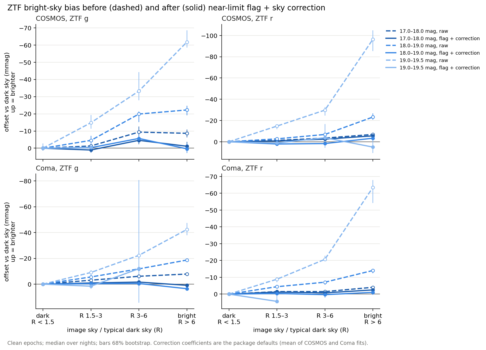
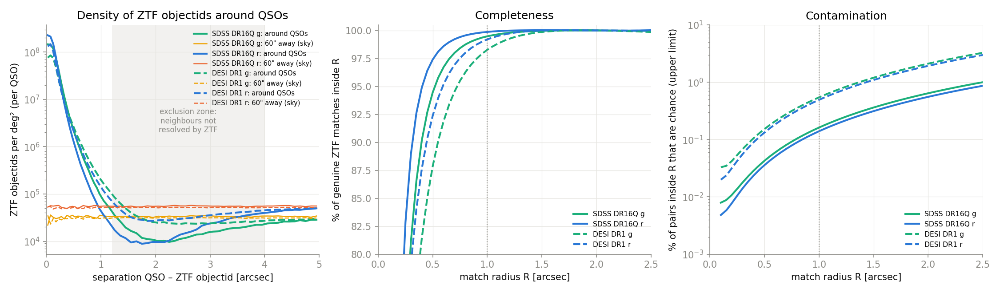
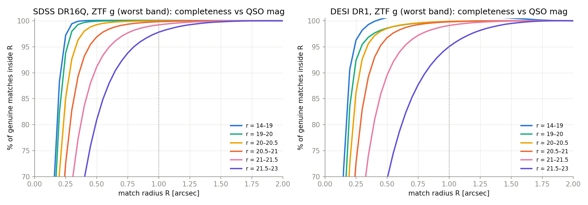
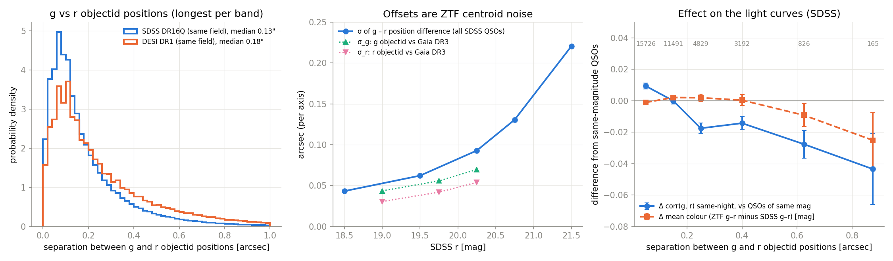
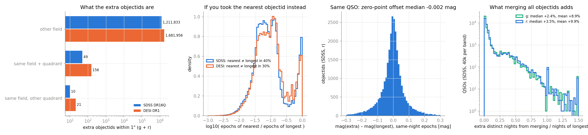

# ztf_lc_bulk

Bulk extraction of **ZTF DR23 or DR24** light curves for a target list. The tool
crossmatches the targets in WSDB against Sergey Koposov's index of the IRSA DR23
parquet release (`koposov.ztf_23_objs` / `koposov.ztf_23_files`, objectid → file).
It then downloads only the files that are needed, from DR23 or DR24
(`--release dr24`), and keeps only the matched objects.

- Use it for lists of more than ~100 targets.
- Faint sources and moonlight: flag near-limit epochs and correct bright-sky light with
  `add_brightsky_columns`; see [Moonlight and bright sky](#moonlight-and-bright-sky).
- Per-epoch image metadata (limitmag, maglimit, zeropoint, seeing, airmass, expid) and
  per-object non-detections: `ztf-lc-bulk exposures`, then `load(..., exposures=True)`.
  See [Per-exposure metadata](#per-exposure-metadata).
- For a handful of objects, or when you need sharp/chi per epoch, use the IRSA
  light-curve API instead.
- Crossmatch radius and multiple objectids per source (SDSS and DESI QSOs): use 1″
  (1.25″ for r > 21.5) and `primary=True`; see
  [Crossmatching QSO catalogues](#crossmatching-qso-catalogues-radius-gr-offsets-extra-objectids).
- **DR24 limitation:** objects are located through the DR23 index, so DR24 output
  holds the full DR24 light curves of objects that already existed in DR23. Objects
  new in DR24 are silently absent. In COSMOS they are 0.9–7.1% of the objects per
  file; all have ≤ 5 epochs and they are faint. See
  [Can the DR23 index be relied on for DR24?](#can-the-dr23-index-be-relied-on-for-dr24).

## Contents
- [Install](#install)
- [Usage](#usage)
  - [Command line](#command-line)
  - [Python](#python)
- [Per-exposure metadata](#per-exposure-metadata)
  - [Why](#why)
  - [Key idea: image properties are shared](#key-idea-image-properties-are-shared)
  - [Where the numbers come from (two IRSA services)](#where-the-numbers-come-from-two-irsa-services)
  - [Scope: which quadrants](#scope-which-quadrants)
  - [Matching epochs to images](#matching-epochs-to-images)
  - [Non-detections](#non-detections)
  - [limitmag vs maglimit](#limitmag-vs-maglimit)
  - [Usage](#usage-1)
  - [exposures.parquet columns](#exposuresparquet-columns)
- [Moonlight and bright sky](#moonlight-and-bright-sky)
  - [The two causes, and what to do about each](#the-two-causes-and-what-to-do-about-each)
  - [How to use it](#how-to-use-it)
  - [What it costs](#what-it-costs)
  - [What it achieves](#what-it-achieves)
  - [Limits](#limits)
- [Crossmatching QSO catalogues: radius, g/r offsets, extra objectids](#crossmatching-qso-catalogues-radius-gr-offsets-extra-objectids)
  - [How ZTF objectids are made (why there are several per QSO)](#how-ztf-objectids-are-made-why-there-are-several-per-qso)
  - [Method](#method)
  - [Q1: which radius?](#q1-which-radius)
  - [Q2: g and r objectids are a fraction of an arcsecond apart](#q2-g-and-r-objectids-are-a-fraction-of-an-arcsecond-apart)
  - [Q3: the extra objectids inside 1″](#q3-the-extra-objectids-inside-1)
  - [Problems found in the input catalogues](#problems-found-in-the-input-catalogues)
- [Output layout (--out run directory)](#output-layout---out-run-directory)
  - [match.parquet](#matchparquet)
  - [lc/*.parquet (and load() output)](#lcparquet-and-load-output)
  - [manifest.jsonl](#manifestjsonl)
- [How it works](#how-it-works)
- [Tests](#tests)
- [Validation run: COSMOS2020 Classic (2026-10-14)](#validation-run-cosmos2020-classic-2026-10-14)
- [DR24: COSMOS2020 Classic (2026-10-14)](#dr24-cosmos2020-classic-2026-10-14)
  - [Can the DR23 index be relied on for DR24?](#can-the-dr23-index-be-relied-on-for-dr24)
- [Exposure metadata: COSMOS DR24 (2026-10-15)](#exposure-metadata-cosmos-dr24-2026-10-15)
- [Known issues and caveats](#known-issues-and-caveats)
- [Claude Code](#claude-code)

## Install

Requirements:
- Python ≥ 3.10.
- A WSDB account. The index tables `koposov.ztf_23_objs` and `koposov.ztf_23_files`
  are readable by the role `dbuser`, which standard WSDB accounts belong to (checked
  2026-10-14). If you get a permission error, ask Sergey Koposov.
- Free disk space for the files in flight. Each raw file is deleted after extraction,
  so this is about `workers × 30 MB` plus the output.

```bash
source ~/Work/venvs/.venv/bin/activate                 # or your own env
pip install -e ~/Work/Code/ztf_lc_bulk                # developers: editable
# pip install git+https://github.com/vasilybelokurov/ztf_lc_bulk.git@v0.2.0   # users
python -m pytest ~/Work/Code/ztf_lc_bulk -q           # offline tests, ~3 s
```

## Usage

### Command line
```bash
# 1. match: a WSDB table ...
ztf-lc-bulk match --table vasily.cosmos2020_classic --id id --ra ra --dec dec \
                  --radius 1.0 --out runs/cosmos
#    ... or a local .parquet/.csv/.fits list (uploaded as a temporary table)
ztf-lc-bulk match --input targets.csv --id name --ra ra --dec dec --out runs/mylist
# 2. extract (resumable: rerun to retry failed files), 3. verify, 4. optional API check
ztf-lc-bulk extract --out runs/cosmos --workers 4      # --mirror /path/to/lc  if you have one
                                                       # --max-gb N  to allow > 50 GB
ztf-lc-bulk verify  --out runs/cosmos
ztf-lc-bulk validate-api --out runs/cosmos --n 40
# 5. optional: per-image metadata -> runs/cosmos/exposures.parquet (COSMOS: 95 s)
ztf-lc-bulk exposures --out runs/cosmos
```

- **Check the size before extracting.** `match` prints `n_files`, `download_gb_est` and
  `download_hours_at_1MBps`. The download is that many **whole** files: DR23 files have
  a median size of 10.5 MB and a mean of 45 MB, and IRSA served 0.7–1.1 MB/s when
  measured.
- `extract` logs the same estimate for the files still to fetch (files found in
  `--mirror` cost nothing). It **refuses to start above 50 GB** unless you pass
  `--max-gb`. In Python, `run_extract(..., max_gb=None)` has no limit.
- File sizes come from `ztf_lc_bulk/data/dr23_file_bytes.parquet` (all 177,218 files).
  It agrees with HTTP Content-Length to 0.2% in total and ±1.5% per file.
- `--where` adds an SQL condition on a WSDB table, using the alias `c`, e.g.
  `--where "c.lp_mass_med < 9.5"`.

### Python
```python
import ztf_lc_bulk as z

z.run_match("runs/x/match.parquet", table="vasily.nsa_v1_0_1", id_col="nsaid")
z.run_match("runs/y/match.parquet", src_id=ids, ra=ra, dec=dec, radius_arcsec=1.0)
z.run_extract("runs/x/match.parquet", "runs/x", workers=4)
assert z.verify("runs/x/match.parquet", "runs/x")["pass"]

df = z.load("runs/x", primary=True)                  # one row per (src_id, band)
lc = z.load("runs/x", src_ids=[123], long=True)      # one row per epoch

z.build_exposures("runs/x")                          # same as `ztf-lc-bulk exposures`
lc = z.load("runs/x", long=True, exposures=True)     # + expid, limitmag, maglimit, seeing, ...
nd = z.nondetections("runs/x", columns=["limitmag", "mjd_mid"])  # images without a detection
```

`load(run_dir, src_ids=None, bands=None, catflags0=True, primary=False, min_epochs=1, long=False, exposures=False)`:

- `catflags0` keeps only epochs with catflags == 0.
- `min_epochs` drops (src_id, objectid) pairs with fewer epochs after the cuts.
- `primary` keeps one objectid per (src_id, band). The ranking is: most epochs after
  cuts, then longest baseline, then smallest separation, then smallest objectid. This
  follows `ztf_qso_parquet/select_primary_lightcurves.py`.
- Without `primary`, every objectid within the radius is kept. For SDSS/DESI QSOs,
  69–73% / 53–59% of source–band pairs have more than one objectid within 1″, nearly
  all from overlapping fields. Why keeping the longest is the right default is shown in
  [Q3](#q3-the-extra-objectids-inside-1).
- `exposures` adds the image columns below to every epoch (needs `exposures.parquet`).

## Per-exposure metadata

### Why
The IRSA light-curve parquet files store five numbers per epoch: `hmjd`, `mag`,
`magerr`, `clrcoeff`, `catflags` (checked against the original DR24 file footer, not just
our extraction). Nothing about the image an epoch came from is included: no depth,
seeing, airmass, zeropoint, Moon phase or exposure id. This feature adds those, plus
the list of images in which an object was **not** detected; light curves contain
detections only, so non-detections are otherwise invisible.

### Key idea: image properties are shared
A ZTF science image is one exposure on one CCD quadrant in one filter (~0.7 deg²).
Its depth, seeing, zeropoint, etc. are the same for every source on it. So the
metadata is retrieved **once per image**, not once per source, and then attached to
every epoch taken on that image.

### Where the numbers come from (two IRSA services)

**Route A: the image catalogue** (IRSA science-image metadata table
`ztf.ztf_current_meta_sci`, queried through IBE:
`https://irsa.ipac.caltech.edu/ibe/search/ztf/products/sci?WHERE=field=<N>&ct=csv`).
- One row per image ever taken, independent of any source.
- One query per ZTF field returns all 64 quadrants × 3 filters. COSMOS field 468:
  104,937 images, 15 MB, 20–40 s; field 1462: 8,059 images, 10–20 s.
- Columns kept: identifiers (`field, ccdid, qid, rcid, fid, filtercode, expid, pid`),
  timing (`obsjd` = exposure start in JD UTC, `exptime`), geometry (centre `ra, dec`;
  corners `ra1..dec4`), quality (`infobits, seeing, airmass, maglimit`) and `moonillf`.
- The same rows are served by IRSA TAP (`ztf.ztf_current_meta_sci`); a check on field
  1462 gave identical rows and `maglimit` values. IBE is used because it is a plain GET.
- `moonesb` (Moon excess sky brightness) exists but is 0 in every COSMOS row, so it
  is dropped.
- Images with `exptime == 0` are dropped.

**Route B: the light-curve API** (`https://irsa.ipac.caltech.edu/cgi-bin/ZTF/nph_light_curves?ID=<objectid>&COLLECTION=ztf_<release>`).
Five per-image quantities exist **only** in the light-curve service, not in the image
catalogue: `limitmag`, `magzp`, `magzprms`, `clrcounc`, `programid`. The API repeats
them in every light curve, on every epoch, together with `expid`. So:
1. For each quadrant (field, rcid, filter), take the image centre from route A and ask
   the WSDB index (`koposov.ztf_23_objs`, q3c cone of 0.65° + field/rcid/filter) for the
   `n_api` (default 3) objects with the most epochs. One SQL query (lateral join) for
   all quadrants; ~0.4 s per quadrant. Choosing from the index, not from the run, makes
   this work when the run's own targets are faint and sparsely sampled.
2. Fetch those light curves from the API (4 threads; IRSA fails at ≥ 16 concurrent).
3. Keep, per `expid`, the five columns. If two light curves report different `limitmag`
   for the same image the build fails (they never have).
4. Join to route A on (field, rcid, fid, expid). `n_api_obj` records how many of the
   light curves contained the image.

The selected objects are a vehicle; their own photometry is not used. A well-sampled
object is detected on almost every image. Over the 253 COSMOS quadrants that have
light curves, 3 objects give `limitmag` for a median 99.2% of the unflagged images
taken before the DR24 cut-off (5th percentile 83%, lowest 78%, in i-band quadrants
with ~20 images). The images they miss are mostly flagged (`infobits ≠ 0`); there the
route-B columns are NaN. Use `--n-api` to query more objects where coverage matters.

Cost (4 threads): COSMOS run quadrants, 108 calls in 32 s; whole fields, 759 calls in
222 s (~0.3 s per call).

### Scope: which quadrants
- Default: the quadrants (field × CCD-quadrant × filter) that hold at least one light
  curve of the run. That is everything `load()` can ever attach.
- `--whole-fields` (`build_exposures(..., whole_fields=True)`): every quadrant and
  filter of the run's fields, e.g. for field-wide bad-night studies. Route A costs
  nothing extra (it already returns whole fields); route B costs 3 calls per extra
  quadrant. COSMOS (fields 468 + 1462): 384 quadrants, 112,996 images, 759 API
  light curves, 4 min. 131 of the 384 quadrants get no API light curve because the
  release has **no light curves there at all** (field 1462 g and i, 3 i-band quadrants
  of 468; confirmed in `koposov.ztf_23_files`): route A still lists their images, route-B
  columns are NaN.

### Matching epochs to images
The parquet `hmjd` is **not** the image time. It is

$$\mathrm{hmjd} = \mathrm{MJD_{UTC}}(\mathrm{obsjd} + \mathrm{exptime}/2) + \frac{\vec r_\oplus \cdot \hat n}{c},$$

the mid-exposure time plus the heliocentric light-travel time for the source direction
$\hat n$ ($\vec r_\oplus$ = Earth's position relative to the Sun; the term is up to
±499 s and varies by ~5 s across one quadrant). The build stores `mjd_mid` and
$\vec r_\oplus / c$ in light-days (`ex, ey, ez`, from astropy) per image, so matching is
pure numpy:
1. Group epochs by (fieldid, rcid, filterid).
2. Find the nearest image using the prediction at the image centre (good to ~5 s).
3. Recompute the prediction at the object's own position for the four neighbouring
   images and take the nearest.
4. Accept if |Δt| ≤ 5 s; otherwise `expid = −1` and NaN columns.

Verified details:
- UTC (not TDB) is the time scale: TDB predictions are off by 69 s.
- Mid-exposure (not start): the 180-s exposures are otherwise off by 90 s.
- Residuals are ≤ 0.46 s (hmjd is stored rounded to 1e-5 d = ±0.43 s); images of one
  quadrant are ≥ 39.6 s apart, so the match is unambiguous.
- The API's `mjd` column is the exposure **start**; its `hjd` is mid-exposure and equals
  parquet `hmjd`.
- Our light-travel time agrees with astropy's heliocentric correction to < 0.01 s.

### Non-detections
`nondetections(run_dir, objectids=None, columns=(), edge_margin=10)` returns, for each
object, the images that should have seen it but have no epoch in its light curve:
- same quadrant (field, rcid, filter) as the object;
- the object lies at least `edge_margin` arcsec inside the image footprint (signed
  distance to the corner polygon in a gnomonic projection). On COSMOS every detection
  is within −1.54″ of its polygon, so the corners are accurate to ~1.5″; the 10″ margin
  avoids sources partly off the chip;
- the image is **in the release**: it holds an epoch of some extracted object or of an
  API light curve (`n_api_obj > 0`). Route A also lists images taken after the release
  cut-off, or never released, which would otherwise count as spurious non-detections;
- all epochs count as detections, whatever their `catflags`.

Output is compact: `objectid`, `exp_row` (row of `read_exposures()`), `edge_dist`
(arcsec), plus any image `columns` requested, e.g.
`nondetections(run, columns=["limitmag", "mjd_mid"])`. COSMOS: 60.7M rows, 44 s, 1 GB.

Caveat: an image is "in the release" if anything in its quadrant was detected on it, so
an image that is in the release but lost for a whole sub-region would appear as
non-detections there. No such case was seen.

### `limitmag` vs `maglimit`
They are different estimates and both are kept:
- `maglimit` (route A) is the science-image header MAGLIM: the median magnitude of
  PSF-catalog sources with S/N ≈ 5 (ZTF Explanatory Supplement, section on image
  limiting magnitudes).
- `limitmag` (route B) is the light-curve "approximate 5σ limiting magnitude
  corresponding to epoch-based PSF-fit catalog" (Explanatory Supplement, light-curve
  table).
- On COSMOS (1,490 images, g/r/i): `limitmag − maglimit` median +0.55 mag, rms 0.21,
  correlation 0.97. A fit `limitmag ≈ 0.72 + 1.008 maglimit − 0.149 seeing` leaves rms
  0.14.
- Which one better predicts actual detection has **not** been established. It can be
  tested with `nondetections()`: at fixed source magnitude, which limit separates
  detected from missed images more sharply?

### Usage
```bash
pip install -e '.[exposures]'                         # astropy, needed only to build
ztf-lc-bulk exposures --out runs/NAME                 # run quadrants
ztf-lc-bulk exposures --out runs/NAME --whole-fields  # all quadrants of the run's fields
ztf-lc-bulk exposures --out runs/NAME --n-api 5       # more API light curves per quadrant
```
```python
import ztf_lc_bulk as z
z.build_exposures("runs/NAME")                        # same as the CLI
exp = z.read_exposures("runs/NAME")                   # the image table
lc  = z.load("runs/NAME", long=True, exposures=True)  # epochs + image columns (starred below)
nd  = z.nondetections("runs/NAME", columns=["limitmag", "maglimit", "mjd_mid"])
```
Rebuilding is cheap: route-A answers are cached per field in `exposures_ibe/` (delete a
file to refresh it); route B is re-queried each build. `exposures.json` holds the build
summary.

### `exposures.parquet` columns
| Column (`load(exposures=True)` adds the starred ones) | Source | Meaning |
|---|---|---|
| `field`, `ccdid`, `qid`, `rcid`, `fid`, `filtercode`, `pid` | A | Image identifiers; rcid = 4 × (ccdid − 1) + qid − 1 |
| `expid`* | A | Exposure id (shared by the 64 quadrants of one exposure); −1 in `load()` if unmatched |
| `obsjd` | A | Exposure start, JD (UTC) |
| `mjd_mid`*, `exptime`* | derived, A | Mid-exposure MJD (UTC); exposure time (s) |
| `ex`, `ey`, `ez` | derived | Earth's heliocentric ICRS position at `mjd_mid` (light-days) |
| `ra`, `dec`, `ra1`..`dec4` | A | Image centre and corners (deg) |
| `maglimit`* | A | Image-header 5σ limit (mag) |
| `limitmag`* | B | Light-curve 5σ limit (mag); NaN if no API light curve covers the image |
| `magzp`*, `magzprms`* | B | Photometric zeropoint and its rms (mag) |
| `clrcounc` | B | Uncertainty of the colour coefficient |
| `seeing`*, `airmass`* | A | Image FWHM (arcsec); airmass |
| `moonillf`* | A | Moon illuminated fraction; signed, range −1…+1 (sign convention not checked; use `|moonillf|`, or compute Moon geometry yourself) |
| `infobits`* | A | Image quality bits; not the same as catflags (see caveats) |
| `programid`* | B | 1 public (MSIP), 2 collaboration, 3 Caltech (Explanatory Supplement) |
| `n_api_obj` | B | Number of API light curves containing the image; 0 = not seen by route B |

## Moonlight and bright sky

Moonlight biases ZTF catalog light curves, and so does any bright sky (twilight, high
airmass, thin cloud). Sources look **brighter** when the sky is bright. For a source of
18–19 mag the bias reaches 10–30 mmag. Near the detection limit it reaches several
tenths of a magnitude. It also produces a spurious 29.5-day period in faint sources.
ZTF's own quality flags do not remove it.

If your sources are brighter than about 17.5 mag, you can ignore all of this: the bias
there is a few mmag. For fainter sources, use the two steps below.

### The two causes, and what to do about each

1. **Detections near the limit are biased bright, and nothing can correct them.** A
   catalog light curve contains only detections. When an image is shallow (bright sky),
   a faint source is detected only when noise happens to push it up, so the epochs that
   survive are too bright. Recovering the true flux of these epochs needs forced
   photometry. **Flag them and drop them.**
2. **Every source gains a little extra light.** On a bright-sky image, every source
   gets about 0.8–0.9 µJy of extra flux for each doubling of the sky brightness. In r,
   every source also loses about 0.2% of its flux per doubling. The extra light is
   small, but on a 19th-mag source (about 90 µJy) under a full Moon it amounts to
   2–3%. **Correct it.**

### How to use it

```python
import ztf_lc_bulk as z

lc = z.load("runs/NAME", long=True, exposures=True, catflags0=False)  # needs `ztf-lc-bulk exposures`
lc = z.add_brightsky_columns(lc)

good = lc[(lc.catflags == 0) & ~lc.near_limit]
mag = good.mag_corr          # corrected magnitudes; use good.mag to skip the correction
```

`add_brightsky_columns` adds:

| Column | Meaning |
|---|---|
| `sky_ratio` | Sky brightness of the image divided by that of a typical dark image of the same CCD quadrant and filter. 1 = dark; about 10 under a full Moon. |
| `mag_ref` | The light curve's normal magnitude: the median over dark-sky nights (`sky_ratio` < 1.5, at least 5 nights) of clean, not-near-limit epochs. |
| `limit_margin` | `maglimit` of the image minus `mag_ref`: how far the source sits above that image's 5σ limit. |
| `near_limit` | `True` when `limit_margin` < 1.3 mag, or when the light curve has no `mag_ref`. Drop these epochs. |
| `mag_corr` | Magnitude with the extra light removed: F′ = (F − k log₂R) / (1 + s log₂R) for R > 1, with k = 0.80 µJy (g), 0.89 µJy (r) and s = 0 (g), −0.0021 (r). Equal to `mag` in i band and on dark images. `magerr` is unchanged. |

The flag uses the source's normal magnitude, not the epoch's magnitude: an epoch is
judged by whether the image was deep enough for this source, not by how bright the
source happened to look. A 19.5-mag source is safe on a deep dark image and unsafe on a
shallow moonlit one.

### What it costs

The flag removes epochs of faint sources. Fraction of clean epochs **kept** (COSMOS and
Coma, DR24):

| Normal mag | 16–17 | 17–18 | 18–19 | 19–19.5 | 19.5–20 | > 20 |
|---|---|---|---|---|---|---|
| g | 100% | 96–98% | 72–78% | 40–49% | 11–15%* | ~0 |
| r | 100% | 96–98% | 66–70% | 26–30% | 5–10%* | ~0 |

\* from the project's validation pipeline (twilight excluded); other columns from the
shipped code.

Light curves of sources fainter than about 19.5 mag lose most of their epochs. For
those sources, catalog photometry under bright skies cannot be rescued; use forced
photometry (ZFPS).

`add_brightsky_columns(lc, margin=1.0)` keeps more data (58–68% at 19–19.5 mag)
but leaves biases of up to ~20 mmag and part of the 29.5-day signal at 19–19.5 mag.

### What it achieves



Tested on two fields (COSMOS at Dec +2°; a field near Coma at Dec +30°), g and r. The
correction coefficients were fitted on one field and tested on the other.

- **Bias versus sky brightness** (clean epochs, relative to dark images). Over 17–19 mag,
  the worst raw offset under bright skies is 4–23 mmag; after the flag and correction it
  is at most 6 mmag. At 19–19.5 mag, raw offsets of 42–96 mmag drop to ≤ 5 mmag (one sparse
  Coma g bin: 12 mmag).
- **The 29.5-day signal in faint sources** (19–20.5 mag). Lomb–Scargle power at the
  lunar period, relative to neighbouring periods (22–38 d), falls from 3–13× to
  0.7–1.0×: no lunar signal remains. (In COSMOS r the raw ratio is only 0.9: the bad
  night MJD 60317, with 296,000 epochs of these sources, dominates the periodograms.
  Without that night the raw ratio is 1.7. See Limits.)
- **Completeness.** At `limit_margin` ≥ 1.3 mag, clean-detection completeness is within
  1% of its bright-source value in every sky-brightness class, in both fields and
  bands ([calibration](docs/flag_calibration.png)).

### Limits

- Validated on two fields, DR24, g and r. The i band gets the flag but no correction.
- `sky_ratio` uses the 25th percentile of each quadrant's images in the run as "typical
  dark"; runs with few images per quadrant (fewer than ~20) make it noisier.
- Light curves with fewer than 5 dark-sky nights get no `mag_ref`, so all their epochs
  are flagged.
- For variables with large amplitudes, `mag_ref` is a median; in faint phases the flag
  is too lenient.
- Bad nights are a separate problem. In COSMOS, night MJD 60317 is a high-cadence
  sequence with a coherent offset that ZTF did not flag; this method does not catch it.
- The extra-light term grows roughly with the logarithm of the sky brightness, not in
  proportion to it. Its physical cause is not established; the correction is empirical.

Derivation, tests and figures: [ztf_moon_systematics](https://github.com/vasilybelokurov/ztf_moon_systematics)
(the full study is its README; scripts `flag_calibration.py`, `validate_flags.py`,
`validate_package.py`, `moon_study.py`).

## Crossmatching QSO catalogues: radius, g/r offsets, extra objectids

Measured on 2026-10-23 for **SDSS DR16Q** (749,329 QSOs) and **DESI DR1** (1,636,845
QSOs: `spectype = 'QSO'`, `zwarn = 0`, `zcat_primary`, after removing duplicates), using
every ZTF DR23 objectid within 5″ in the index. Scripts and run order:
[`studies/qso_crossmatch/`](studies/qso_crossmatch/).

**Summary**
- **Use a 1″ radius.** It contains 99.5% (g) / 99.9% (r) of the genuine matches of
  SDSS QSOs and 98.3% / 99.2% for DESI QSOs; at most 0.16% (SDSS) and 0.5% (DESI) of
  the matched pairs are chance neighbours. For QSOs fainter than r ≈ 21.5 (mostly DESI)
  use 1.25″: 1″ holds only 95–98% of their matches.
- **g and r objectids 0.1–0.6″ apart are normal** and do not change the light curves.
  Each is a centroid from a different reference image; the offset is centroid noise.
- **Extra objectids inside 1″ are the same QSO in an overlapping field** (> 99.98% of
  them). Keep the one with the most epochs (`primary=True`). Merging them adds a
  median of 2–4% more nights.

### How ZTF objectids are made (why there are several per QSO)
Light curves are built by matching single-exposure PSF-fit detections to "seed" sources
from the deeper reference-image (co-add) catalogue. That is done separately for each
field, CCD quadrant and filter, and `objra`/`objdec` are the seed position "from the
input Reference Image (seed) catalog corresponding to the fieldid, rcid, and filterid"
([DR23 release notes](https://irsa.ipac.caltech.edu/data/ZTF/docs/releases/dr23/ztf_release_notes_dr23.pdf),
Sections 3 and 12c). ZTF also tiles the sky with two overlapping grids (primary and
secondary). So one QSO has
- a different objectid in each band, at a slightly different position (Q2 below), and
- a further objectid in each band for every other field that covers it (Q3 below).

### Method
- `pull.py`: for every QSO, all ZTF objectids within 5″ (`q3c_join` against
  `koposov.ztf_23_objs`, probes sorted by `q3c_ang2ipix`), plus the same list shifted
  by +60″ in Dec as a "random sky" control. SDSS positions are the DR16Q (SDSS
  imaging) positions; DESI positions and magnitudes come from `desi_dr1.photometry`
  (Legacy Surveys). In the magnitude bins below, "r" is SDSS PSF r for SDSS QSOs and
  Legacy Surveys r (22.5 − 2.5 log₁₀ flux_r) for DESI QSOs.
- The density of ZTF objectids around a QSO is a narrow core (the QSO itself) on top
  of a background. **Near a real source the background is not the sky value:** ZTF
  cannot resolve a second source within about one PSF width, so between 1.2″ and
  about 4″ the density is only 0.2–0.5× (SDSS) and 0.55–0.87× (DESI) of the density 60″
  away (left panel). The shifted control therefore overestimates chance matches near
  the QSO by up to 5×. The estimators used here are:
  - background = density of the real profile at 1.5–2.5″, assumed constant inward.
    The exclusion is stronger closer in, so contamination is an **upper limit**;
  - completeness C(R) = (pairs inside R − background × πR²) / (the same at 2″).
- Light-curve tests use DR23 light curves of all objectids within 1″ of the DR16Q QSOs
  (`$ZTF_QSO_LC_DIR`) and only catflags == 0 epochs.

### Q1: which radius?



| Radius | SDSS g | SDSS r | DESI g | DESI r | Chance pairs (upper limit), SDSS / DESI |
|---|---|---|---|---|---|
| 0.5″ | 94.5% | 97.4% | 87.9% | 92.4% | 0.04% / 0.15% |
| 0.75″ | 98.4% | 99.4% | 95.5% | 97.5% | 0.09% / 0.32% |
| **1.0″** | **99.5%** | **99.9%** | **98.3%** | **99.2%** | **0.16% / 0.54%** |
| 1.25″ | 99.8% | 100% | 99.4% | 99.8% | 0.25% / 0.84% |
| 1.5″ | 100% | 100% | 99.9% | 100% | 0.36% / 1.2% |
| 2.0″ | 100% | 100% | 100% | 100% | 0.64% / 2.1% |

The band columns give completeness: the percentage of genuine matches inside the
radius. The last column is the fraction of matched pairs that are chance neighbours;
it is quoted for the worse band (g).

The radius grows with magnitude because ZTF centroids get noisier. Radius that holds
99% of the genuine matches:

| r (mag) | < 19 | 19–20 | 20–20.5 | 20.5–21 | 21–21.5 | > 21.5 |
|---|---|---|---|---|---|---|
| SDSS, g / r | 0.30″ / 0.25″ | 0.35″ / 0.30″ | 0.50″ / 0.35″ | 0.70″ / 0.50″ | 0.95″ / 0.70″ | 1.20″ / 1.00″ |
| DESI, g / r | 0.35″ / 0.25″ | 0.60″ / 0.30″ | 0.60″ / 0.35″ | 0.70″ / 0.45″ | 1.00″ / 0.65″ | 1.40″ / 1.25″ |



At 1″ completeness is ≥ 99.8% at r < 21 in both catalogues and both bands. For
r > 21.5 it is 97.8% (SDSS g), 95.0% (DESI g) and 97.6% (DESI r). There the radius can
go to 1.25–1.5″ at a cost of ≤ 1.1% chance pairs.

Not every QSO has a ZTF counterpart. Within 1″: SDSS 94% (g) / 96% (r), DESI 76% / 84%.
The rest are too faint for the ZTF reference images, or lie outside DR23 (Dec < −30°).

### Q2: g and r objectids are a fraction of an arcsecond apart



- **Size.** For the longest g and r objectids within 1″: SDSS median 0.13″, 90% < 0.41″,
  99% < 0.86″; DESI median 0.18″, 90% < 0.59″, 99% < 1.09″ (same field).
- **Cause: centroid noise of the two reference images.** The objectid positions were
  checked against Gaia DR3 (3,136 SDSS QSOs with r < 20.5 in ra 180–190°, dec 10–30°;
  `gaia_check.py`):

  | r (mag) | N | σ(g objectid − Gaia) | σ(r objectid − Gaia) | σ(g − r) |
  |---|---|---|---|---|
  | < 19.5 | 1775 | 0.044″ | 0.030″ | 0.043″ |
  | 19.5–20 | 560 | 0.056″ | 0.042″ | 0.060″ |
  | 20–20.5 | 801 | 0.070″ | 0.054″ | 0.080″ |

  All σ are per axis. σ(g − r) rises to 0.13″ at r = 20.5–21 and 0.22″ at r > 21. The g
  and r errors are partly shared (correlation 0.45–0.78 against Gaia). This is
  consistent with both reference images of a field being tied to Gaia by the same kind
  of solution, so σ(g − r) is smaller than √(σ_g² + σ_r²). (SDSS DR16Q positions differ
  from Gaia by 0.047″ per axis.)
- **Effect on the light curves: none of practical size.** The magnitude of each epoch
  comes from that epoch's own detection; the seed position only decides which
  detections belong to the objectid. 36,623 SDSS QSOs with ≥ 30 epochs in g and r in
  the same field were tested. Each QSO was compared with QSOs of the same magnitude
  (0.1-mag bins), to remove the trend that fainter QSOs have both larger separations
  and noisier light curves. Two quantities were checked: the correlation of g and r
  variations on the same night, and the mean colour (ZTF g − r minus SDSS g − r).

  | g − r separation | N | Δ correlation | Δ colour (mag) |
  |---|---|---|---|
  | 0–0.1″ | 15726 | +0.009 ± 0.002 | −0.001 ± 0.001 |
  | 0.1–0.2″ | 11491 | 0.000 ± 0.002 | +0.002 ± 0.001 |
  | 0.2–0.3″ | 4829 | −0.018 ± 0.003 | +0.002 ± 0.002 |
  | 0.3–0.5″ | 3192 | −0.014 ± 0.004 | 0.000 ± 0.004 |
  | 0.5–0.75″ | 826 | −0.028 ± 0.009 | −0.009 ± 0.007 |
  | 0.75–1.0″ | 165 | −0.044 ± 0.023 | −0.025 ± 0.018 |

  The typical same-night g–r correlation is 0.3–0.75, depending on magnitude; the
  changes are ≤ 0.04 of that. The colour is unchanged to < 0.01 mag up to 0.75″. The
  small loss of correlation at large separation may be residual magnitude dependence
  (those QSOs are the faintest in their 0.1-mag bin) or the occasional blend.

### Q3: the extra objectids inside 1″



| | SDSS DR16Q | DESI DR1 |
|---|---|---|
| QSO–band pairs with ≥ 2 objectids within 1″ (g / r) | 69% / 73% | 53% / 59% |
| Extra objectids from another field | 1,211,833 | 1,681,956 |
| Same field and quadrant (duplicate entries) | 49 | 156 |
| Same field, other quadrant | 10 | 21 |
| Epochs of an extra / epochs of the longest (median) | 0.08 | 0.10 |
| Nearest objectid is not the longest | 40% | 30% |
| … and then the nearest has (median) | 8% of the epochs | 9% of the epochs |

- **They are the same QSO.** In both catalogues more than 99.98% are the QSO in an
  overlapping field, and chance neighbours are ≤ 0.5% of pairs (Q1). In r for 30,000
  SDSS QSOs, an other-field objectid shares no epochs with the longest one (median 0
  shared). Its magnitude on the same nights agrees: median offset −0.002 mag; scatter
  0.017 mag at r < 19, 0.032 at 19–20, 0.053 at 20–20.5, 0.079 at 20.5–21, 0.11 at r > 21.
- **Same-quadrant duplicates** (rare) have about 96% identical epochs with identical
  magnitudes: the same detections assigned to two seeds 1.4–2″ apart, with the QSO
  between them.
- **Why the longest and not the nearest.** The objectid nearest to the QSO is chosen
  by noise: separations are 0.1–0.2″ either way, within the centroid errors of Q2. When
  it is not the longest (30–40% of cases), it is usually a short light curve from a
  secondary field, with 8–9% of the epochs. Ranking by number of epochs picks the field
  where the QSO is observed most, with no extra cost.
- **What merging all objectids would add** (40,000 random SDSS QSOs per band, union of
  clean epochs):

  | | g | r |
  |---|---|---|
  | Extra epochs, median / mean | +4.7% / +17% | +5.7% / +18% |
  | Extra distinct nights, median / mean | +2.4% / +8.9% | +3.5% / +9.9% |
  | QSOs gaining > 25% nights | 12.7% | 13.5% |
  | QSOs whose baseline grows by > 30 d | 4.7% | 6.2% |

  Most extra epochs fall on nights the longest light curve already covers. Merging
  also needs a zero-point offset per field (above). So `primary=True` loses about 7–8%
  of all nights in the sample and avoids that calibration. Merge only for work limited
  by cadence (lags, periodicity), and fit the field offsets as free parameters.
- How many QSOs have extra objectids depends on the sky (field overlaps). In the
  COSMOS2020 run, 22% of source–band pairs had a second field; near Coma, 99%.

### Problems found in the input catalogues
- **DESI DR1: 8,997 duplicate entries.** The same QSO appears under two `targetid`s,
  both with `zcat_primary`. Of the DESI entries sharing a ZTF objectid within 1″,
  96.6% are at the same position to 0.000″ and 98.8% have |Δz| < 0.01. `desi_dedup.py`
  keeps the lower `targetid`. Without this, 1.3% of DESI QSOs would be counted twice.
- **DESI positions:** use the Legacy Surveys position (`desi_dr1.photometry.ra/dec`).
  The RA/Dec in a private DESI QSO table used during this work differed from it by a
  median 0.06″ (99th percentile 0.29″), enough to bias a sub-arcsecond study.

## Output layout (`--out` run directory)

| Path | Content |
|---|---|
| `match.parquet` | One row per (target, ZTF objectid) pair within the radius |
| `lc/file_<fileid>.parquet` | One row per ZTF objectid; one file per IRSA input file; zstd |
| `manifest.jsonl` | One JSON line per file attempt (append-only) |
| `exposures.parquet`, `exposures.json` | Per-image metadata and build summary (`exposures` command) |
| `exposures_ibe/` | IBE query cache, one parquet per field |
| `raw/` | Files being downloaded (`*.part` until complete); empty after a clean run |

### `match.parquet`
| Column | Type | Meaning |
|---|---|---|
| `src_id` | as input | Target id |
| `objectid` | int64 | ZTF DR objectid. It is unique per band and field/CCD/quadrant, so g and r ids never coincide |
| `filterid` | int16 | 1 = g, 2 = r, 3 = i |
| `fieldid`, `rcid` | int16 | ZTF field; readout channel (0–63) = 4 × (CCD − 1) + quadrant − 1 |
| `fileid`, `filename` | int, str | Index file id; path relative to `https://irsa.ipac.caltech.edu/data/ZTF/lc/` |
| `nepochs` | int16 | Number of epochs according to the index |
| `sep_arcsec` | float64 | Separation between target and ZTF object position (arcsec) |

### `lc/*.parquet` (and `load()` output)
| Column | Type | Unit / meaning |
|---|---|---|
| `objectid`, `filterid`, `fieldid`, `rcid` | int | As above |
| `objra`, `objdec` | float32 | ZTF object position (deg, J2000) |
| `nepochs` | int64 | Length of each list column |
| `hmjd` | list[float64] | Heliocentric MJD (days), **sorted ascending**, stored rounded to 1e-5 d |
| `mag`, `magerr` | list[float32] | PSF-fit magnitude and its error, as delivered by IRSA (mag) |
| `clrcoeff` | list[float32] | Colour coefficient of the photometric calibration |
| `catflags` | list[int32] | Per-epoch quality bits; 0 = clean. 32768 (bit 15) is the most common flag |

`load()` adds `src_id`, `band`, `sep_arcsec` and `baseline_days` (last − first hmjd,
after cuts). In nested form the list columns are numpy arrays.

### `manifest.jsonl`
Each line records: `fileid`, `filename`, `status` (`ok` or `failed`), `n_requested`,
`n_written`, `n_missing`, `n_epochs`, `bytes_downloaded`, `t_fetch`, `t_extract`,
`time`, and `error` on failure.

## How it works
1. **match**: one materialized-CTE `q3c_join` of the target list against
   `ztf_23_objs`, joined to `ztf_23_files`. A single join beats batched queries
   (~30 s vs 30–60 min for 2.6M matches in `ztf_qso_parquet`).
2. **extract**: the unique objectids are grouped by file. For each file the tool:
   - uses the mirror if one is given, otherwise downloads it over HTTPS. Downloads go to
     `*.part` and are renamed only if the size matches Content-Length; HTTP
     408/425/429/5xx are retried with backoff (2·2^k s, cap 60 s, Retry-After honoured);
     404 fails immediately;
   - reads only the matched objectids with pyarrow;
   - sorts epochs by hmjd (the raw arrays are not time-ordered);
   - writes the output via tmp + rename, then deletes the raw file.

   A rerun skips files whose output exists and retries failed ones.
3. **verify**: compares the output with the match table (see Tests).
4. **exposures** (optional): one image-catalogue query per field (route A) plus 3 API
   light curves per quadrant (route B) give a per-image table; `load()` attaches it to
   epochs by quadrant + predicted heliocentric time. See
   [Per-exposure metadata](#per-exposure-metadata).

## Tests

```bash
python -m pytest -q                 # offline: 36 tests, no network
python -m pytest -m network -v      # WSDB + IRSA: 3 tests, ~50 s, downloads ~6 MB
```

| File | Test | What it checks |
|---|---|---|
| `test_offline.py` | `sort_epochs_matches_naive` | Vectorised per-row time sort equals numpy argsort row by row, for all list columns |
| | `sort_epochs_on_sliced_table` | Correct when the Arrow list offsets do not start at 0 |
| | `extract_selects_and_reports_missing` | Only requested ids are returned, unknown ids are reported, and mag stays paired with hmjd after sorting |
| | `plan_groups_unique_objects` | Grouping by file; objects matched by two targets are extracted once |
| | `pipeline_end_to_end_resume_and_failure` | Synthetic mirror of 3 files plus 1 unreachable file. 3 ok and 1 failed (no crash); a rerun skips the 3 and retries the failure; mirror files are never deleted; `verify` passes |
| | `file_size_table` | Shipped size table has all 177,218 files and totals 7.97 TB; two files agree with IRSA Content-Length to < 2%; duplicate file ids are counted once |
| | `extract_refuses_large_download` | Above `max_gb`, extract raises before any download; the same files in a mirror count as 0 GB and extraction proceeds |
| | `release_filename` | DR23 index paths map to the DR24 tree (`lc_dr24/…_dr24.parquet`); unknown releases are rejected |
| | `run_dir_cannot_mix_releases` | A run directory records its release in `run.json`; extracting another release into it raises |
| `test_fetch.py` | `ok` | Download, and no second request if the file exists |
| | `retry_then_ok_and_retry_after` | 503 → backoff 2 s, 503 with Retry-After: 7 → waits 7 s, then success |
| | `short_read_is_retried` | A truncated body is rejected and retried, with no `.part` left behind |
| | `404_not_retried_and_no_file_left` | Fatal status: one request, no file |
| | `gives_up_after_retries` | Persistent 500 → exactly `retries` requests, then `FetchError` |
| `test_load.py` | `filter_epochs_basic` | Epoch mask rebuilds the lists and nepochs |
| | `load_raw_no_cuts` | Join to targets, band names, baseline, an objectid shared by two targets |
| | `load_catflags_and_min_epochs` | catflags cut; an object with all epochs flagged is dropped |
| | `load_primary` | Primary = most clean epochs |
| | `load_primary_tiebreak_baseline` | The ranking changes as expected when the cuts change |
| | `load_long` | Epoch-level output, row counts per object |
| `test_network.py` | `local_upload_equals_table_match` | Uploaded-list match gives exactly the same pairs as the WSDB-table match (COSMOS 1′ box) |
| | `extract_verify_load_and_api` | Real IRSA download → `verify` passes → `load(primary)` gives one row per (src, band) → API comparison passes |
| | `exposures_end_to_end` | `build_exposures` on a real i-band run: every epoch matches an image; limitmag present on all clean epochs and equal to the API's per epoch for 2 objects; non-detections respect the edge margin |
| `test_exposures.py` | `predict_hmjd_matches_astropy` | Our Earth-vector light-travel time equals astropy's heliocentric correction to < 0.01 s (50 random times/positions) |
| | `match_epochs_picks_right_image_and_rejects` | Object 0.4° off the image centre, images 40 s apart: correct image; epoch with no image → −1; other quadrant / no quadrant handled |
| | `edge_distance` | Signed distance to the footprint edge (inside, 10″ in, 5″ out, far outside) |
| | `load_with_exposures` | Long and nested `load(exposures=True)` carry the right expid/limitmag/maglimit; plain `load` unchanged |
| | `load_unmatched_epoch_gets_minus_one` | An epoch 0.5 d from any image gets expid −1 and NaN |
| | `nondetections` | Undetected images found; images not in the release excluded; edge margin applied |
| | `unit_vector_norm` | Unit vectors |
| `test_brightsky.py` | `sky_ratio_per_quadrant` | R = sky / 25th percentile, separately per quadrant |
| | `sky_ratio_ignores_flagged_images_and_fills_magzp` | Flagged images excluded from the dark level; missing magzp filled with the quadrant median |
| | `reference_mag_dark_clean_nights_only` | Only clean, dark-sky nights; at least 5 nights |
| | `reference_mag_iterates_away_from_near_limit` | Near-limit (bright-biased) epochs dropped from the reference |
| | `near_limit_flag` | Threshold at 1.3 mag; light curves without a reference are flagged |
| | `correction_round_trip_and_scope` | Exactly undoes an injected additive + scale term; R ≤ 1 and i band untouched |
| | `correction_nan_when_flux_not_positive` | Non-positive corrected flux gives NaN |
| | `read_exposures_adds_sky_ratio` | `read_exposures` computes `sky_ratio` for older exposure tables |
| | `build_exposures_whole_fields` | With IRSA/WSDB stubbed: default scope = run quadrants only; `whole_fields` = every quadrant of the fields, and the API is asked about each |

**`verify` checks** (run on every real extraction): every matched objectid is present
exactly once, with no extra rows; `nepochs` equals the length of all five list columns;
hmjd is non-decreasing; filterid/fieldid/rcid agree with the index. nepochs must
equal the index value for DR23 and be at least that value for DR24.

**`validate-api`**: for a sample of objects (half random, half drawn from the 2,000
longest light curves), it queries
`nph_light_curves?ID=<oid>&COLLECTION=ztf_<release>` and matches epochs by time. An object passes if every parquet epoch has an API epoch within
1e-5 d and mag, magerr and catflags agree within 1e-5. API-only epochs are reported
separately.

## Validation run: COSMOS2020 Classic (2026-10-14)

All ZTF DR23 light curves within 1″ of every source in COSMOS2020 Classic
(WSDB table `vasily.cosmos2020_classic`, 1,720,700 sources over a 3.4 deg² bounding
box) were extracted in **about 11 minutes** in total. Almost all of that time was
download.

| Step | Result |
|---|---|
| match (1″) | 1,720,700 targets → 186,359 pairs, 88,676 sources, 185,079 objectids, 36 files; 16 s |
| extract | 36/36 files, 423.7 MB downloaded in 644 s (0.66 MB/s, 4 workers); 14,439,542 epochs; output 144 MB. The size estimate was 0.424 GB |
| verify | pass. catflags == 0 for 95.6% of epochs |
| validate-api (40 objects) | 40/40 pass. All 19,216 parquet epochs found; \|Δt\| ≤ 0.42 s, \|Δmag\| ≤ 5e-8 |
| `load(primary=True)` | 150,374 light curves for 87,110 sources (g 31,877, r 79,061, i 39,436); 1.2 s |

**Coverage.** Only 5.2% of COSMOS sources (88,676) have a ZTF object within 1″,
because most COSMOS sources are far fainter than the ZTF single-epoch limit (about
20.5–21 mag). After the catflags == 0 cut, with one primary light curve per source
and band:

| Band | Sources | Median clean epochs | 90th percentile | Sources with ≥ 100 epochs |
|---|---|---|---|---|
| g | 31,877 | 9 | 252 | 7,871 |
| r | 79,061 | 11 | 582 | 19,348 |
| i | 39,436 | 10 | 55 | 0 |

22,329 sources have light curves in all of g, r and i, and 38,335 in r only. Most
light curves are short: these are faint objects near the limit, detected on the
better nights only.

**Files.** The files used were field 468 (g, r, i; 9 quadrants each) and field 1462
(r; 9 quadrants). Each quadrant file covers about 0.74 deg², and 30.4% of the
609,226 objects in them were needed.

## DR24: COSMOS2020 Classic (2026-10-14)

The same match table was extracted again with `--release dr24` into `runs/cosmos_dr24`:

```bash
cp runs/cosmos/match.parquet runs/cosmos_dr24/
ztf-lc-bulk extract --out runs/cosmos_dr24 --release dr24 --workers 4
ztf-lc-bulk verify  --out runs/cosmos_dr24
ztf-lc-bulk validate-api --out runs/cosmos_dr24 --n 40        # queries ztf_dr24
python scripts/compare_releases.py runs/cosmos runs/cosmos_dr24
```

| Step | DR23 | DR24 |
|---|---|---|
| Download | 423.7 MB, 644 s (0.66 MB/s) | 476.8 MB, 679 s (0.70 MB/s); the estimate was 0.51 GB |
| Light curves / epochs | 185,079 / 14,439,542 | 185,079 / 16,343,555 (+13%) |
| Last epoch (MJD) | 60613 (2024 Oct) | 60961 (2025 Sep) |
| verify | pass | pass |
| validate-api (40 objects) | 40/40; 38 API-only epochs (0.2%) | 40/40; **0** API-only epochs; \|Δt\| ≤ 0.43 s, \|Δmag\| ≤ 5e-8 |
| catflags == 0 | 95.6% | 91.5% |
| Output | 144 MB | 163 MB |

**DR23 → DR24 per epoch** (all 185,079 objects, from `scripts/compare_releases.py`):
- Every DR23 epoch is present in DR24 with identical time, mag and clrcoeff.
- **magerr was recomputed for 99.999% of epochs.** The median ratio DR24/DR23 is
  0.998, with 1–99% range 0.989–1.107 and a maximum change of 0.012 mag. By band
  the median ratio is g 1.005, r 0.997, i 1.024.
- **catflags changed for 3,215 epochs (0.02%)**, almost all 0 → 32768, between MJD
  60296 and 60318 (Dec 2023–Jan 2024).
- **1,904,013 epochs were added.** Of these, 584k on nights MJD 60707–60709 (Jan 2025)
  are all flagged 32768: about 235k epochs per night, apparently a high-cadence
  COSMOS sequence. The `catflags == 0` cut removes them, which explains the lower
  clean fraction.
- DR24 also adds epochs inside the DR23 time span (MJD 60248–60613). This is
  consistent with the DR23 parquet lacking some epochs that the DR23 API had.

After `load(primary=True)` (catflags == 0):

| Band | Sources DR23 → DR24 | Median epochs | 90th percentile | ≥ 100 epochs | Median baseline (d) |
|---|---|---|---|---|---|
| g | 31,877 → 31,920 | 9 → 10 | 252 → 289 | 7,871 → 8,297 | 1,620 → 2,219 |
| r | 79,061 → 79,111 | 11 → 12 | 582 → 611 | 19,348 → 19,688 | 1,752 → 1,889 |
| i | 39,436 → 39,531 | 10 → 13 | 55 → 72 | 0 → 0 | 827 → 1,207 |

### Can the DR23 index be relied on for DR24?

**Short answer:** yes, for every object that already existed in DR23: you get its
complete, correct DR24 light curve. No, for objects that are new in DR24: they are
silently absent. In the files tested, the new objects are faint and almost all have
a single epoch.

**How DR24 is reached.** WSDB indexes DR23 only. `--release dr24` takes each matched
DR23 objectid and its DR23 file path and reads the file of the same field, band, CCD
and quadrant from `lc_dr24/` instead (`release_filename()`). This is valid only if
DR24 keeps the DR23 objectids in the same files.

**What was tested, and how.**

1. *Whole-file comparison of three COSMOS quadrants*
   (`scripts/compare_release_files.py`). Both releases of each file were downloaded,
   and **all** objects in the quadrant were compared, not just matched ones. An
   object is "new" if its objectid appears in the DR24 file but not in the DR23
   file; each file lists every object of its quadrant, so this is a complete count.

   | File | DR23 objects | DR24 objects | Only in DR23 | Only in DR24 (new) | Position shift | DR23 epochs all in DR24 | mag identical |
   |---|---|---|---|---|---|---|---|
   | `ztf_000468_zi_c03_q1` | 12,214 | 12,946 | 0 | 732 (5.7% of DR24) | 0″ | 12,214 / 12,214 | 12,214 / 12,214 |
   | `ztf_001462_zr_c10_q2` | 15,279 | 15,419 | 0 | 140 (0.9%) | 0″ | 15,279 / 15,279 | 15,279 / 15,279 |
   | `ztf_000468_zg_c08_q4` | 13,611 | 14,644 | 0 | 1,033 (7.1%) | 0″ | 13,611 / 13,611 | 13,611 / 13,611 |

   The new objects are short and faint:

   | File | New objects | With 1 epoch | With ≤ 5 epochs | With ≥ 10 epochs | Median mag |
   |---|---|---|---|---|---|
   | `ztf_000468_zg_c08_q4` | 1,033 | 90% | 100% | 0 | 21.27 |
   | `ztf_000468_zi_c03_q1` | 732 | 92% | 100% | 0 | 20.49 |
   | `ztf_001462_zr_c10_q2` | 140 | 99% | 100% | 0 | 20.46 |

   For comparison, the median over all objects in these DR24 files is 3–9 epochs.

2. *Full COSMOS run* (36 files, 185,079 matched objectids): every DR23 objectid was
   found in its DR24 file (`n_missing = 0`), every DR23 epoch is in DR24 with identical
   time and mag (`scripts/compare_releases.py`), and 40 of 40 objects agree exactly
   with the IRSA `ztf_dr24` API, which had no extra epochs.

**What can be relied on:**
- **Objects present in DR23 get their full DR24 light curves.** Shown in 1 and 2.
- **A breakdown of the index would be loud, not silent.** If a DR23 objectid were ever
  missing from its DR24 file (renumbered, moved or dropped), `extract` would count it
  in `missing` / `n_missing` (also in `manifest.jsonl`) and `verify` would fail. On
  COSMOS this count was 0 in all 36 files.

**What cannot be relied on:**
- **Objects new in DR24 are silently missing.** A target whose only ZTF counterpart
  first appears in DR24 gets no light curve and no warning.
- **The fraction of targets affected is not measured.** The 0.9–7.1% above counts new
  objects in whole quadrants (~0.74 deg² each), not within 1″ of targets. Given that
  the new objects have ≤ 5 epochs and median mag 20.5–21.3, the loss for light-curve
  work is expected to be small. That is an inference from three files, not a
  measurement.
- **Only COSMOS was tested:** 3 files compared in full, plus 36 files for the matched
  objects. Other fields, especially crowded ones, have not been checked.

**Recommendation.**
- Light curves of known, reasonably bright objects (variability studies): use DR24
  through the DR23 index.
- Completeness-sensitive work, such as a census down to the ZTF limit, or targets
  near the limit: the new DR24 objects matter. Either use DR23 consistently, or
  measure the loss first. Re-run with `--keep-raw`, match the targets against
  all objects in the downloaded DR24 files, and count targets that gain a new
  counterpart. That measurement has not been done yet.

## Exposure metadata: COSMOS DR24 (2026-10-15)
Run `runs/cosmos_dr24` (36 quadrants, 185,079 light curves).
- Build: 2 IBE queries (113k images) + 108 API light curves, 95 s in total;
  15,294 images in the run's quadrants, 87.7% with limitmag (the rest are mostly after
  the DR24 cut-off).
- Matching: **all 16,343,555 epochs matched**, max |Δt| 0.459 s (hmjd rounding is
  ±0.43 s); the next image is always ≥ 39.6 s away. 4 s run time.
- limitmag present on 99.9993% of epochs, 100% of catflags == 0 epochs. 12 random
  objects (1,020 epochs) not used to build the table: expid and limitmag equal the API's.
- Footprint: every detection lies within −1.54″ of its image's corner polygon; 0.6%
  lie < 10″ inside the edge.
- `--whole-fields` rebuild: 384 quadrants, 112,996 images, 759 API light curves, 4 min.
  The 36 run quadrants come out identical (15,294 rows, all values equal). Across the
  253 quadrants that have light curves, `limitmag` is present for a median 99.2% of
  unflagged images before the DR24 cut-off (MJD 60960.5); 5th percentile 83%, lowest
  78% (field 468 i-band quadrants with ~20 images each). Raise `--n-api` to improve
  coverage there.
- Non-detection fraction on infobits = 0 images, median per light curve:
  0 below 18 mag; 0.2–1.2% at 18–19; 10–25% at 19–20; 35–78% at 20–20.5;
  64–96% at 20.5–21 (g/r/i; i worst).

## Known issues and caveats
- **`catflags` is not derived from `infobits` alone.** COSMOS (228k epochs): 18,138
  epochs have infobits ≠ 0 but catflags < 32768; 829 have catflags ≥ 32768 with
  infobits = 0.
- **The API's `ztf_dr23` collection has 0.2% more epochs than the DR23 parquet
  release**: 38 of about 19,250 in the sample, all at MJD 60248–60374 (Nov 2023–Mar
  2024) and 22 on night 60352. DR24 parquet and the `ztf_dr24` API agree exactly.
- **Throughput.** IRSA serves about 0.7–1.1 MB/s, and 4 workers were no faster than one
  `curl`. The download size is set by sky area, not by the number of sources: a whole
  file must be fetched to read any object in it. All of DR23 is 177,218 files and
  7.97 TB. All NSA v1_0_1 galaxies (641,409) would need 83,894 files, 1.48 TB:
  about 17 days at 1 MB/s.
- **DR24 relies on the DR23 index** and so silently misses objects new in DR24. If
  the index ever broke for an existing object, `verify` would fail (see
  [Can the DR23 index be relied on for DR24?](#can-the-dr23-index-be-relied-on-for-dr24)).
  The DR24 size estimate scales the DR23 sizes by 1.2 (measured per-file ratios:
  1.10–1.31; COSMOS total 1.125), so treat it as approximate. Including the new
  objects would need a DR24 index, or the IRSA HATS release on S3, best run from AWS
  us-east-1.
- **Remote partial reads do not help.** Each file is a single parquet row group, so
  DuckDB httpfs cannot skip rows.
- **`sqlutilpy.get(..., driver='duckdb')` scrambles list columns in sqlutilpy ≤ 0.27.**
  This is fixed in 0.28.0, which we verified on two DR23 files: 1–62 epochs, single
  and multi-row queries, ragged lengths. This package reads parquet with pyarrow and
  does not use the duckdb driver. If you query the files yourself with it, use
  sqlutilpy ≥ 0.28.
- **objectids are per band and field.** Several per source are normal, with
  complementary epochs and a zero-point offset between fields. For SDSS QSOs the median
  offset is −0.002 mag, and the scatter between QSOs grows from 0.017 mag (r < 19) to
  0.11 mag (r > 21). Use `primary=True`, or fit the offsets; do not concatenate them
  blindly. See [Q3](#q3-the-extra-objectids-inside-1).

## Claude Code
`.claude/skills/ztf-lc/SKILL.md` tells Claude when and how to use this package instead of
writing new API downloaders. To use it from any project:
`ln -s ~/Work/Code/ztf_lc_bulk/.claude/skills/ztf-lc ~/.claude/skills/ztf-lc`.
